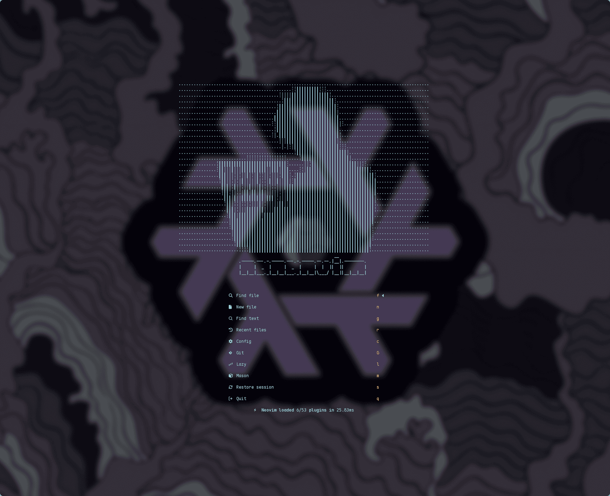
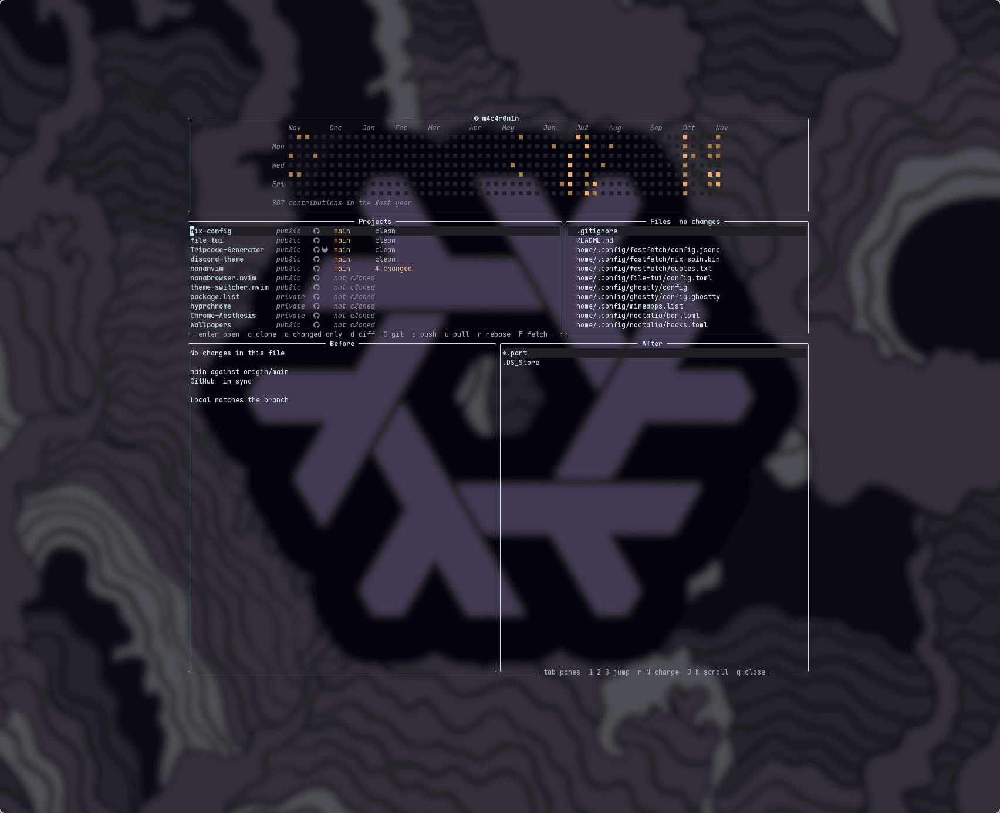

# nananvim

  
  
  
  
  
  

TIRED OF LAZYVIM? WANT SOMETHING LESS BLOATED? TRY NANANVIM! In all seriousness, I didn't build this for stars, I didn't build it to compete with anyone or anything like that. I built it for me, with just the things I find useful in day to day life and kept adding more as work demanded it. I figure *maybe* someone else will stumble upon this and want something a bit lighter and easier to customize and learn; but is also ready to use out of the box. Or maybe someone just looking for something new and bored with everything else. So I documented it.

Latest: I've added a bunch of quality of life stuff (sessions, oil, harpoon, multiple cursors, a test runner, diffview, NananvimUpdate command, rendered markdown and more), and your own settings now live in one file that updates never touch. Web dev is in too: Vue, Svelte, Astro, MDX and working Emmet. Full rundown in the [CHANGELOG](CHANGELOG.md).

---

**[<kbd>   Install   </kbd>](docs/installation.md)**
**[<kbd>   Features   </kbd>](docs/features.md)**
**[<kbd>   Configure   </kbd>](docs/customization-guide.md)**
**[<kbd>   Keybindings   </kbd>](KEYBINDINGS.md)**
**[<kbd>   Troubleshooting   </kbd>](docs/troubleshooting.md)**

---

## Why nananvim?

Because why not. I don't do promoting, so it's like you'll be part of an exclusive club! One of neovim's best kept secrets, if you will. And while you're here, here are some specs:

- **Kinda fast**: ~35ms startup on average, everything else waits for its trigger
- **Built on Neovim 0.12, not around it**: native LSP, commenting, selection and borders, less plugin glue
- **Custom plugins**: a [Browser │ Terminal │ TODO workspace](https://github.com/m4c4r0n1n/nana-panels.nvim) and a [live theme switcher](https://github.com/m4c4r0n1n/theme-switcher.nvim)
- **Batteries included, bloat optional**: completion UI, linting, debugging and tests each turn off with one `false`
- **Updates don't eat your settings**: your stuff lives in one gitignored file, `lua/config/local.lua`
- **AI is opt-in**: nothing loads until you make that file
- **Tested, not vibes**: every push installs on Arch, Fedora, Debian, Ubuntu, NixOS, Void, Gentoo and macOS

## Screenshots
Some of these are a bit old, I'll update them soon. But clone it and check the tools for yourself!

  
  

  
  
  

  
  

## License

Apache-2.0

---

Made with ❤️ (and way too much caffeine).

